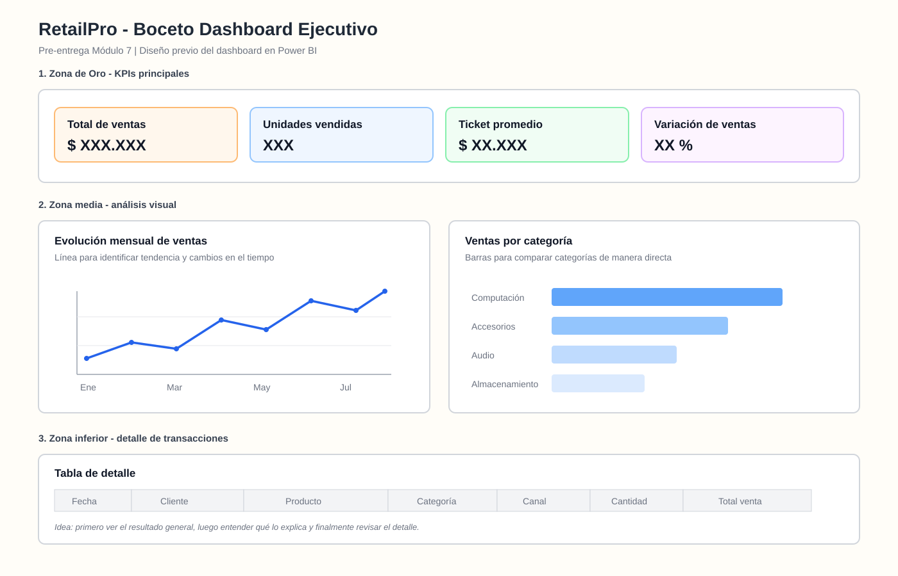

# Módulo 7 - Boceto del Dashboard RetailPro

## Proyecto RetailPro

Este directorio contiene la pre-entrega correspondiente al Módulo 7 del proyecto integrador RetailPro.

El objetivo de esta etapa es planificar la estructura visual del dashboard antes de construirlo en Power BI, definiendo la jerarquía de información, los KPIs principales, los gráficos y la zona de detalle.

---

## Propósito del dashboard

**Identificar la evolución de las ventas de RetailPro y las categorías que explican sus principales variaciones para apoyar decisiones comerciales.**

---

## Boceto del Dashboard

El diseño sigue un patrón de lectura en Z, priorizando primero los indicadores ejecutivos, luego los gráficos de análisis y finalmente el detalle de las transacciones.

---

## Estructura del dashboard

### Zona superior - Zona de Oro

La zona superior contiene los cuatro KPIs principales del proyecto:

1. **Total de Ventas**
2. **Unidades Vendidas**
3. **Ticket Promedio**
4. **Variación de Ventas**

Estos indicadores permiten obtener una lectura rápida del desempeño general del negocio antes de profundizar en los gráficos de análisis.

---

### Zona media izquierda - Evolución mensual de ventas

Se utiliza un **gráfico de líneas** para representar la evolución de las ventas a lo largo del tiempo.

Esta visualización permite identificar:

- tendencias de crecimiento o disminución;
- períodos con aumentos o caídas;
- cambios relevantes en el comportamiento mensual de las ventas.

---

### Zona media derecha - Ventas por categoría

Se utiliza un **gráfico de barras** para comparar el nivel de ventas entre las distintas categorías de productos.

Las principales categorías consideradas son:

- Computación;
- Accesorios;
- Audio;
- Almacenamiento.

Esta visualización permite identificar rápidamente qué categorías presentan un mayor o menor nivel de ventas.

---

### Zona inferior - Detalle de transacciones

La parte inferior del dashboard está destinada a una tabla de detalle con información de las ventas individuales.

Se consideran campos como:

- Fecha;
- Cliente;
- Producto;
- Categoría;
- Canal;
- Cantidad;
- Total de venta.

Esta sección permite revisar los registros que explican los resultados observados en los indicadores y gráficos superiores.

---

## Justificación de los KPIs

### Total de Ventas

Representa el resultado económico general del período analizado y permite conocer el nivel total de facturación generado por RetailPro.

Conceptualmente:

`SUM(total_venta)`

### Unidades Vendidas

Permite analizar el volumen comercial independientemente del valor monetario de los productos.

Conceptualmente:

`SUM(cantidad)`

Este indicador ayuda a distinguir si un aumento en las ventas se explica por una mayor cantidad de unidades comercializadas o por productos de mayor valor.

### Ticket Promedio

Representa el valor promedio generado por cada transacción.

Conceptualmente:

`Total de Ventas / Cantidad de transacciones`

Este indicador complementa el análisis de facturación y volumen de ventas.

### Variación de Ventas

Permite comparar el desempeño entre períodos e identificar crecimiento o disminución en las ventas.

Conceptualmente:

`((Ventas período actual - Ventas período anterior) / Ventas período anterior) * 100`

Este indicador permite evaluar la evolución del desempeño comercial y no solamente observar el total de ventas de manera aislada.

---

## Justificación de las visualizaciones

### Gráfico de líneas

Se utiliza un gráfico de líneas para representar la evolución mensual de las ventas porque el tiempo corresponde a una variable ordenada.

Este tipo de visualización facilita la identificación de tendencias, aumentos y disminuciones a lo largo del período analizado.

### Gráfico de barras

Se utiliza un gráfico de barras para comparar las ventas entre categorías porque permite observar de forma directa las diferencias de magnitud entre grupos.

Este tipo de visualización facilita la identificación de las categorías con mayor y menor nivel de ventas.

---

## Relación con el brief del Módulo 1

El diseño mantiene continuidad con las preguntas de análisis definidas previamente en el brief del proyecto RetailPro.

El dashboard busca apoyar el análisis de:

- evolución de las ventas a través del tiempo;
- diferencias de desempeño entre categorías;
- comportamiento general del volumen comercial;
- oportunidades de mejora y crecimiento.

Los KPIs entregan una visión ejecutiva del desempeño, mientras que los gráficos permiten profundizar en los factores que explican los resultados.

---

## Diferenciación entre resumen y detalle

El dashboard se organiza en tres niveles de lectura:

### 1. Resumen ejecutivo

Los cuatro KPIs de la Zona de Oro permiten conocer rápidamente el estado general del negocio.

### 2. Análisis

Los gráficos de evolución mensual y ventas por categoría permiten identificar tendencias y diferencias relevantes.

### 3. Detalle

La tabla inferior permite revisar las transacciones individuales que explican los resultados agregados.

La lógica de lectura propuesta es:

`Resumen → Análisis → Detalle`

---

## Patrón de lectura en Z

El boceto sigue el patrón de lectura en Z solicitado para la pre-entrega:

1. La lectura comienza en los KPIs de la zona superior.
2. Continúa hacia el gráfico de evolución mensual.
3. Se desplaza hacia el gráfico de comparación por categorías.
4. Finaliza en la tabla de detalle de transacciones.

Esta estructura permite presentar primero la información más relevante y aumentar progresivamente el nivel de detalle.

---

## Elementos visuales principales

El diseño contempla:

1. Zona de Oro con cuatro KPIs.
2. Gráfico de evolución mensual de ventas.
3. Gráfico de ventas por categoría.
4. Tabla de detalle de transacciones.

La estructura evita sobrecargar el dashboard y mantiene una lectura simple y ejecutiva.

---

## Criterios de aceptación

- El propósito está redactado en una sola frase orientada a la acción.
- El boceto respeta el patrón de lectura en Z.
- Los cuatro KPIs del proyecto se encuentran en la Zona de Oro.
- El dashboard no supera los seis elementos visuales principales.
- Se utiliza un gráfico de líneas para la tendencia temporal.
- Se utiliza un gráfico de barras para la comparación entre categorías.
- La justificación conecta el diseño con las preguntas de análisis del brief del Módulo 1.
- Se diferencia claramente entre zona de resumen, análisis y detalle.

---

## Archivo principal

- `dashboard_boceto_retailpro_canva.svg`

---

## Herramientas utilizadas

- Canva para el diseño del boceto.
- Power BI para la posterior construcción del dashboard.
- GitHub para documentación y versionado del proyecto.

---

## Próximo paso

Este boceto será utilizado como guía para construir el dashboard definitivo de RetailPro en Power BI, manteniendo la misma jerarquía visual, KPIs y tipos de visualización definidos en esta etapa.
